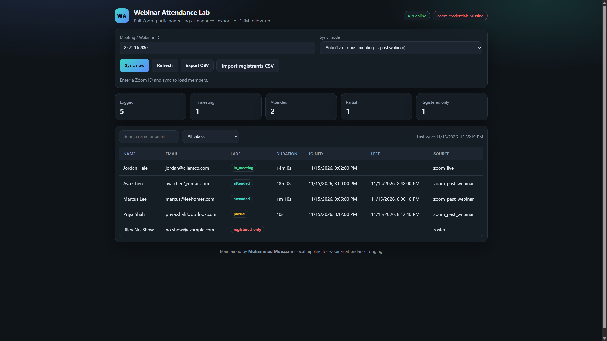

<div align="center">

# Webinar Attendance Lab

### A client productivity tool for Zoom meetings & webinars

Pull every participant from Zoom, log attendance with useful detail, and review it on a clean local dashboard — then export CSV for CRM / Zapier follow-up.

**Developer & Maintainer:** [Muhammad Muazzain](https://github.com/MuhammadMuazzain)

</div>

---

<p align="center">
  
</p>

Built for freelancers and operators who run Zoom sessions for clients and need a fast way to answer: **who joined, how long they stayed, and who registered but never showed.**

```
Zoom API  →  sync pipeline  →  SQLite log  →  dashboard + CSV export
                                ↑
                     optional registrants CSV
```

---

## Why teams use it

| Need | What you get |
|:-----|:-------------|
| Live or past sessions | Sync meeting / webinar participants from Zoom |
| Clear attendance labels | `in_meeting` · `attended` · `partial` · `registered_only` |
| Client handoff | Modern dashboard + CSV export for tagging in any CRM |
| No-show visibility | Import a registrant roster and mark who never joined |
| Local & private | Runs on your machine; credentials stay in `.env` |

Typical use: client webinars, training calls, investor sessions — anywhere attendance must feed follow-up without rebuilding a full marketing stack.

---

## Features

- **Live sync** via Zoom Dashboard metrics API  
- **Past meeting / webinar reports** when the session has ended  
- **Auto mode** tries live → past meeting → past webinar  
- **Search & filter** by name, email, or label  
- **Registrant CSV import** (`email`, optional `name`)  
- **One-click CSV export** for Zapier / CRM workflows  

---

## Quick start

```bash
git clone https://github.com/MuhammadMuazzain/webinar-attendance-lab.git
cd webinar-attendance-lab
python -m venv .venv
# Windows PowerShell:
.\.venv\Scripts\Activate.ps1
pip install -r requirements.txt
copy .env.example .env
```

Add Zoom **Server-to-Server OAuth** values in `.env`:

```
ZOOM_ACCOUNT_ID=...
ZOOM_CLIENT_ID=...
ZOOM_CLIENT_SECRET=...
```

Common scopes (account admin app):

- `dashboard:read:list_meeting_participants:admin` (live)
- meeting / webinar **report** read scopes (past sessions)

Start the dashboard:

```bash
python -m app.main
```

Open **http://127.0.0.1:5080**

CLI sync:

```bash
python scripts/sync_meeting.py 1234567890 --mode auto
```

---

## Dashboard walkthrough

1. Enter the Zoom meeting or webinar ID  
2. Click **Sync now**  
3. Review counts (logged / in meeting / attended / partial / registered only)  
4. Optionally import a registrant CSV to surface no-shows  
5. **Export CSV** for client CRM or Zapier  

---

## Project layout

```
app/           FastAPI API, Zoom client, SQLite store, sync pipeline
static/        Dashboard UI
scripts/       CLI sync helper
tests/         Unit tests
docs/assets/   Screenshots
data/          Local SQLite (gitignored)
```

---

## Tests

```bash
pip install pytest
pytest -q
```

---

## Ownership

| Role | Person |
|:-----|:-------|
| Developer | **Muhammad Muazzain** |
| Maintainer | **Muhammad Muazzain** |
| Sole contributor | **Muhammad Muazzain** |

---

## Notes

- Keep Zoom secrets in `.env` — never commit them.  
- Live metrics need Zoom Dashboard API access on the account.  
- Past reports appear after Zoom finishes processing the session.  
- CSV export is CRM-agnostic so you can map tags however the client works.

---

<div align="center">

**Muhammad Muazzain** · Developer & Maintainer  
[github.com/MuhammadMuazzain](https://github.com/MuhammadMuazzain)

</div>
